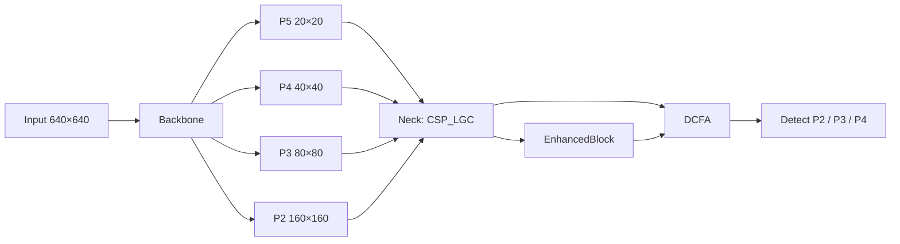

# AMAF-YOLO

面向小目标检测的改进 YOLO 模型。项目在 Ultralytics YOLOv8 / YOLO11 的基础上，引入动态跨区域注意力与多尺度特征融合，针对 VisDrone2019 等航拍、密集小目标场景优化检测精度。

> 论文：**AMAF-YOLO: dynamic cross-region attention and multi-scale fusion for small object detection**  
> 作者：Qiang Sun, Jinhua Zhang, Shurong Zeng, Jun Hu, Kangmei Li  
> 期刊：*Nondestructive Testing and Evaluation*, 2025  
> DOI: [10.1080/10589759.2025.2586076](https://doi.org/10.1080/10589759.2025.2586076)

## 目录

- [主要特点](#主要特点)
- [网络结构](#网络结构)
- [目录结构](#目录结构)
- [环境依赖与安装](#环境依赖与安装)
- [数据集准备](#数据集准备)
- [模型配置](#模型配置)
- [训练](#训练)
- [验证与测试](#验证与测试)
- [推理](#推理)
- [权重说明](#权重说明)
- [自定义模块](#自定义模块)
- [引用](#引用)
- [致谢与许可](#致谢与许可)

## 主要特点

- **高分辨率浅层特征检测头**：在原有检测尺度之外引入 160×160 的高分辨率特征图（相对 640 输入，下采样倍率为 4），与 80×80、40×40 三个尺度共同送入检测头，增强小目标的空间定位能力。
- **动态跨区域融合注意力（DCFA）**：在颈部特征融合处使用 `GS_EMA + CADP`，其中 `CADP` 组合卷积注意力 `CAB` 与窗口多头自注意力 `W-MSA`，在通道、空间和窗口区域之间建立长距离依赖。
- **轻量全局上下文 CSP 结构（CSP_LGC）**：用 `LGC` 全局上下文注意力替换传统 Bottleneck，在保持轻量的同时增强通道语义建模。
- **跨层残差增强块（EnhancedBlock）**：通过双分支下采样与残差捷径，强化浅层小目标特征在多尺度融合中的表达。
- **兼容 Ultralytics 工作流**：训练、验证、推理均复用 Ultralytics 的 `YOLO` API，可快速迁移现有数据集和训练脚本。

## 网络结构

整体结构为「骨干网络 → 颈部多尺度融合 → 三尺度检测头」。



> 注：`ultralytics/cfg/models/mycfg/AMAF-YOLO.yaml` 中的注释将检测头写为 P3–P5，但按特征图尺寸（160、80、40）实际对应下采样倍率 4、8、16，即 P2、P3、P4。README 以实际特征图尺寸为准。

## 目录结构

```text
AMAF-YOLO/
├── train.py                 # 训练入口
├── val.py                   # 验证/测试入口
├── 环境测试.py              # CUDA / PyTorch 环境检查
├── runs/
│   └── detect/
│       └── AMAF-YOLO.pt     # 已训练权重
└── ultralytics/
    ├── cfg/models/mycfg/
    │   └── AMAF-YOLO.yaml   # 模型结构配置
    ├── model_file/          # 预训练权重
    ├── mydata/
    │   └── VisDrone2019/
    │       └── VisDrone2019.yaml
    └── nn/
        ├── my_modules/      # 自定义模块
        └── tasks.py         # 已注册自定义模块的解析逻辑
```

## 环境依赖与安装

推荐环境：

- Python 3.8–3.10
- PyTorch（CUDA 版本）
- torchvision
- ultralytics（本仓库已内置修改版，无需单独安装官方包）
- `timm`
- `mmengine`

安装示例（Windows，CUDA）：

```bash
git clone https://github.com/SQ-TT/AMAF-YOLO.git
cd AMAF-YOLO

# 按自己的 CUDA 版本安装 PyTorch，例如：
pip install torch torchvision --index-url https://download.pytorch.org/whl/cu118

pip install timm mmengine
```

安装完成后，先在仓库根目录下运行环境检查：

```bash
python 环境测试.py
```

脚本会输出 GPU 数量、显卡型号、PyTorch 版本以及 `torch.cuda.is_available()` 结果。

## 数据集准备

仓库默认使用 VisDrone2019 目标检测数据集，类别定义见 `ultralytics/mydata/VisDrone2019/VisDrone2019.yaml`：

```yaml
names:
  0: pedestrian
  1: people
  2: bicycle
  3: car
  4: van
  5: truck
  6: tricycle
  7: awning-tricycle
  8: bus
  9: motor
```

将 VisDrone2019 数据集整理为 YOLO 格式后，目录建议如下：

```text
VisDrone2019/
├── images/
│   ├── train/
│   ├── val/
│   └── test/
└── labels/
    ├── train/
    ├── val/
    └── test/
```

同时确认 `VisDrone2019.yaml` 中的 `train`、`val`、`test` 路径指向你的实际目录。

## 模型配置

模型结构文件：`ultralytics/cfg/models/mycfg/AMAF-YOLO.yaml`。

默认配置中 `nc: 80` 用于 COCO。训练 VisDrone2019 前，请将其改为自己的类别数，例如：

```yaml
nc: 10
```

训练脚本 `train.py` 中的数据路径为本地绝对路径，请按需修改为你的 VisDrone2019 路径。

## 训练

编辑 `train.py` 中的数据路径与超参数后运行：

```bash
python train.py
```

`train.py` 中的主要训练参数如下，可按硬件条件调整：

```python
epochs=300
batch=16
imgsz=640
optimizer="SGD"
lr0=0.01
lrf=0.01
momentum=0.937
weight_decay=5e-4
dropout=0.05
patience=0
cos_lr=True
```

如需断点续训，取消 `resume` 参数注释并指向对应的 `last.pt` 即可。

## 验证与测试

训练完成后，将 `val.py` 中的权重路径改为你的 `best.pt`，然后运行：

```bash
python val.py
```

验证脚本默认参数：

```python
split='val'
imgsz=448
conf=0.001
iou=0.6
max_det=300
half=False
rect=True
```

如需计算 COCO 指标，可将 `save_json` 设为 `True`。

## 推理

也可以直接在代码中加载权重进行推理：

```python
from ultralytics import YOLO

model = YOLO("runs/detect/AMAF-YOLO.pt")
results = model.predict("path/to/image.jpg", imgsz=640, conf=0.25)
```

## 权重说明

- `runs/detect/AMAF-YOLO.pt`：仓库提供的 AMAF-YOLO 检测权重。
- `ultralytics/model_file/yolov8n.pt`、`yolov8s.pt`：Ultralytics 预训练权重，可在需要时作为骨干网络初始化来源。

## 自定义模块

自定义模块位于 `ultralytics/nn/my_modules/`，并已在 `ultralytics/nn/tasks.py` 的 `parse_model` 中注册：

| 模块 | 说明 |
| --- | --- |
| `CAB` | 双卷积路径 + 通道注意力 |
| `CADP` | `CAB + W-MSA + MLP` 的跨区域注意力块 |
| `W_MSA` | 带相对位置偏置的窗口多头自注意力 |
| `GS_EMA` | 分组高效多尺度注意力 |
| `DCFA` | 动态跨区域融合注意力，`GS_EMA + CADP` |
| `LGC` | 轻量全局上下文注意力 |
| `CSP_LGC` | 用 `LGC` 替换 Bottleneck 的 CSP 结构 |
| `EnhancedBlock` | 跨层残差 + 双分支下采样增强块 |
| `CBAM` | 通道 + 空间注意力 |
| `GAM` | 全局注意力机制 |
| `ECA` | 高效通道注意力 |

## 引用

如果本项目或论文对你的研究有帮助，请引用：

```bibtex
@article{sun2025amaf,
  title   = {AMAF-YOLO: dynamic cross-region attention and multi-scale fusion for small object detection},
  author  = {Sun, Qiang and Zhang, Jinhua and Zeng, Shurong and Hu, Jun and Li, Kangmei},
  journal = {Nondestructive Testing and Evaluation},
  year    = {2025},
  pages   = {1--31},
  doi     = {10.1080/10589759.2025.2586076}
}
```

## 致谢与许可

本项目基于 [Ultralytics YOLO](https://github.com/ultralytics/ultralytics) 二次开发，保留其 AGPL-3.0 许可证要求。使用本仓库代码时，请遵守相应开源协议。
